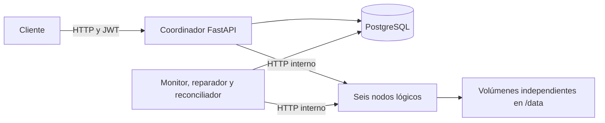

# Memoria técnica de YachayRepo

## Project Overview

Repositorio institucional académico de Yachay Tech para publicar, clasificar, versionar y recuperar documentos aun cuando fallen nodos de almacenamiento. El backend gestiona escuelas, materias, tipos documentales, usuarios y permisos. La interfaz incorpora autenticación, perfil y consulta académica con visor PDF.

## Technology Stack

Python 3.14 en las imágenes Docker, FastAPI, Uvicorn, Pydantic, HTTPX, PostgreSQL, SQLAlchemy 2, Psycopg 3 y Alembic. JWT con PyJWT y contraseñas con Argon2id. Docker Compose organiza los procesos y los volúmenes. Pytest, HTTPX ASGI/MockTransport y PostgreSQL aislado cubren las pruebas automatizadas. Las versiones están fijadas en `backend/requirements*.txt`.

## System Architecture

El catálogo central registra identidad, permisos, metadatos y estados. Los nodos publican archivos y metadatos locales en sus volúmenes. Los procesos de mantenimiento pueden ejecutarse independientemente. Compose puede reunirlos para laboratorio o separar coordinador, catálogo y almacenamiento entre hosts. Un contenedor lógico no equivale a un dominio de fallo físico.

## Repository Map

| Ubicación | Responsabilidad |
|---|---|
| `backend/app/main.py`, `api/` dentro de `backend/app/` | Entrada ASGI y rutas de salud, documentos, materias, catálogos, autenticación, usuarios y operaciones |
| `backend/app/services/` | Orquestación documental, materias, autenticación, salud, diagnóstico de réplicas, reparación y reconciliación |
| `backend/app/config.py`, `database.py`, `schemas/` dentro de `backend/app/` | Configuración, sesiones y contratos |
| `backend/app/models/catalog.py`, `backend/migrations/`, `backend/app/seed.py` | Modelos ORM, evolución del esquema y carga institucional idempotente |
| `backend/app/auth.py`, `backend/auth/` | Principal y permisos, primitivas JWT/Argon2id y bootstrap administrativo |
| `backend/storage/main.py`, `application.py` y `document_store.py` dentro de `backend/storage/` | Entrada ASGI del nodo, HTTP interno y persistencia/verificación |
| `backend/{monitor,repair,reconciliation}/main.py` | Entradas de los tres procesos periódicos |
| `backend/tests/`, `infrastructure/docker/`, `docs/` | Pruebas, configuración de despliegue y guías |
| `frontend/` | SPA React para autenticación, inicio y perfil. Entrada en `frontend/src/main.tsx` |
| `infrastructure/raspberry/` | Marcador para despliegue físico |
| `prototype/`, `experiments/json-interchange/` | Implementaciones históricas de Workshops 6 y 7 |

## Core Workflows

- **Catálogo y documentos.** `api/documents.py` delega en `services/document_service.py` dentro de `backend/app/`. El catálogo relaciona documentos, versiones, réplicas, escuelas, tipos y materias N:M. La clasificación pertenece al documento. Las consultas omiten borrados lógicos y hay restauración e historial de versiones. Los archivos previos con metadatos JSON conservan compatibilidad de lectura según el flujo aplicable.
- **Subida.** Se registran estados pendientes, se transfieren bytes por HTTP y se confirma la publicación al alcanzar el número de copias verificadas. RF=3 es el valor predeterminado de Compose y RF=1 sigue disponible. Las versiones son inmutables y la versión actual debe pertenecer al documento.
- **Lectura.** El coordinador resuelve réplicas en PostgreSQL, prueba alternativas y valida longitud y SHA-256 antes de entregar bytes. La pérdida de un nodo admite failover mientras quede una copia utilizable.
- **Fallos y reinicios.** `health_monitor.py` aplica umbrales y persiste salud. `replica_repair.py` recupera déficits de versiones publicadas desde copias verificables y gestiona limpieza de exceso. `upload_reconciliation.py` usa trabajos e intentos durables para recuperar subidas iniciales incompletas y publicar al alcanzar el objetivo. PostgreSQL y los volúmenes conservan estado entre reinicios. El alcance y las excepciones se detallan en las guías respectivas.
- **Acceso.** JWT académico, Argon2id y control por membresías. Una membresía activa de profesor en la escuela autoriza las subidas, incluso para administradores. Usuarios autenticados pueden leer documentos publicados de otras escuelas. La administración de cuentas tiene alcance global o escolar según rol y carece de registro público. El tráfico de servicio utiliza credenciales internas.

## Architectural Decisions

- PostgreSQL es la fuente de verdad del catálogo y un punto único de fallo. Los bytes se guardan en los nodos.
- Verificar SHA-256 independientemente en la transferencia y conservar versiones anteriores. Mantener la unicidad de réplica por versión y host físico y la FK compuesta de nodo y host.
- Mantener las transferencias fuera de las transacciones largas. Los estados persistentes permiten coordinar confirmación, reintentos y reparación.
- Aplicar cambios de esquema por Alembic y cargar el catálogo por seed. Las revisiones 01–06 cubren esquema inicial, tipos, materias, reparación, reconciliación y RBAC. El head de código observado es `20261124_06`.

## Current Project Status

- Corte del 25 de noviembre de 2026. `main` en `3b4c626`, alineada con la referencia local `origin/main`. Árbol limpio antes de este análisis. Historial reciente en `feature/*` y `fix/*`, con merges sucesivos de RF3, failover, monitor, reparación, reconciliación y RBAC.
- Implementados catálogo PostgreSQL, versionado y borrado lógico, tipos y materias, RF3, failover, monitor, reparación, reconciliación inicial y autenticación/RBAC. El código y Compose demuestran disponibilidad de las funciones, y su activación depende de la configuración del despliegue.
- Parcial. Compatibilidad con JSON histórico sin importación automática. El rate limiter vive por proceso y la sesión utiliza exclusivamente access tokens.
- Fase 7.1. SPA de autenticación y perfil en español con React, TanStack Router y Query, Axios y modo claro. Playwright comprobó el flujo contra FastAPI y PostgreSQL aislados.
- Fase 7.2. Consulta de escuelas y materias, búsqueda paginada, historial, descargas autenticadas y visor PDF con worker local. El E2E de laboratorio valida el visor con failover y compara SHA-256.
- Pendientes documentados. Portal de escritura del profesor, paneles de administración y operaciones, despliegue físico Raspberry Pi, HA de PostgreSQL, OAuth, correo, cifrado de archivos y balanceo. RabbitMQ pertenece al prototipo en el estado observado.
- Validación local de este corte. Pytest se detuvo al importar `argon2` en la virtualenv existente, antes de recolectar pruebas. La guía de RBAC registra un E2E del 24 de noviembre con RF3, failover, reconciliación y revocación. Ese resultado es histórico. El estado de instancias en ejecución y la topología física no se comprobaron.
- Algunas guías de etapas anteriores conservan referencias a RF=1 o revisiones antiguas. Comprueba el head en el código y el estado de la base de destino antes de usar procedimientos históricos.

## Documentation Index

- [Portal académico 7.2](docs/frontend-academic-portal.md) para consulta paginada, versiones, visor PDF y pruebas de failover en navegador.

- [Frontend 7.1](docs/frontend-foundation.md) para levantar la SPA, integrar autenticación y ejecutar sus pruebas.

- [README](README.md) para entrada general y perfiles. [Dos hosts](docs/two-host-deployment.md) para topología y arranque distribuido.
- [PostgreSQL](docs/postgresql.md) para conexión y respaldo. [Integración documental](docs/postgresql-document-integration.md) para catálogo y compatibilidad JSON. [Pruebas PostgreSQL](docs/postgresql-testing.md) para aislamiento.
- [Almacenamiento](docs/document-storage.md) para protocolos y volúmenes. [Versionado](docs/document-versioning-soft-delete.md) y [materias](docs/document-subjects.md) para contratos y prácticas manuales.
- [RF3](docs/rf3-replication.md) para escritura. [Readiness](docs/rf3-readiness.md) conserva el diseño previo. [Failover](docs/read-failover.md) y [monitor](docs/health-monitoring.md) describen lecturas y detección.
- [Reparación](docs/replica-repair.md) y [reconciliación](docs/upload-reconciliation.md) para recuperación y escenarios E2E. [RBAC](docs/authentication-rbac.md) para matriz de acceso, bootstrap y evidencia E2E.

## Context Maintenance

Usa el mapa para abrir el mínimo de archivos y secciones necesarios. Contrasta discrepancias con el código y la configuración del checkout. Al cerrar cada tarea actualiza este documento si cambia la arquitectura, una fase relevante o una restricción técnica. Registra procedimientos reutilizables en [SKILLS.md](SKILLS.md). Sustituye la información obsoleta y conserva resultados con su alcance y fecha. Deja ambos archivos intactos cuando la tarea no aporte contexto duradero.
