# YachayRepo

La Fase 7.4 añade el [panel administrativo](docs/frontend-administration.md)
para cuentas, membresías, catálogos, documentos y auditoría.

La Fase 7.3 incorpora el [portal del profesor](docs/frontend-professor-portal.md)
para publicar, versionar y gestionar documentos propios.

La Fase 7.2 agrega el [portal académico y visor PDF](docs/frontend-academic-portal.md)
con búsqueda, filtros, historial y descargas autenticadas.

La Fase 7.1 incorpora un frontend en español para iniciar sesión, consultar el
perfil y cambiar la contraseña. Consulta la [guía del frontend](docs/frontend-foundation.md)
para iniciarlo en `http://localhost:5173` y conectarlo al coordinador.

YachayRepo es un proyecto académico de Sistemas Distribuidos para construir y
evaluar un repositorio institucional tolerante a fallos. La Etapa 3 permite
cargar, consultar y descargar documentos mediante el coordinador y los seis
nodos institucionales distribuidos entre dos computadoras Ubuntu.

> No se deben almacenar documentos institucionales reales, confidenciales o
> sensibles en este entorno académico.

## Arquitectura implementada

La [integración final](docs/frontend-final-integration.md) documenta
las revisiones de metadatos y la cancelación de publicaciones por borrado.

La [monitorización distribuida](docs/frontend-distributed-dashboard.md) reúne
topología, salud, réplicas por versión y reconciliación en `/admin/operations`.

```mermaid
flowchart TD
    Client[Cliente] -->|HTTP puerto 8000| Coordinator[Coordinador FastAPI]
    Monitor[Monitor periódico] -->|GET /health| Bio[node-bio]
    Monitor -->|GET /health| Phy[node-phy]
    Monitor -->|GET /health| Math[node-math]
    Monitor -->|GET /health| Chem[node-chem]
    Monitor -->|GET /health| Earth[node-earth]
    Monitor -->|GET /health| Agro[node-agro]
    Monitor -->|health y last_seen_at| PostgreSQL[(PostgreSQL)]
    Repair[Reparador de réplicas] -->|consulta y reservas| PostgreSQL
    Repair -->|transferencia verificada| Bio
    Repair -->|transferencia verificada| Phy
    Repair -->|transferencia verificada| Math
    Repair -->|transferencia verificada| Chem
    Repair -->|transferencia verificada| Earth
    Repair -->|transferencia verificada| Agro
    Reconciler[Reconciliador de subidas] -->|trabajos y auditoría| PostgreSQL
    Reconciler -->|verifica y completa réplicas| Bio
    Reconciler -->|verifica y completa réplicas| Math
    Reconciler -->|verifica y completa réplicas| Agro
    User[Usuario autenticado] -->|JWT y RBAC| Coordinator
    Coordinator -->|GET /health| Bio[node-bio]
    Coordinator -->|GET /health| Phy[node-phy]
    Coordinator -->|GET /health| Math[node-math]
    Coordinator -->|GET /health| Chem[node-chem]
    Coordinator -->|GET /health| Earth[node-earth]
    Coordinator -->|GET /health| Agro[node-agro]
```



El **coordinador** es el único punto de acceso publicado al equipo anfitrión.
Su endpoint `GET /health` informa exclusivamente sobre el propio coordinador;
`GET /nodes` consulta los seis nodos concurrentemente mediante HTTPX y valida
la identidad de cada respuesta.

Un **nodo de almacenamiento** es un servicio FastAPI independiente que, en esta
etapa, conserva documentos y metadatos JSON dentro de su volumen. Los seis
contenedores ejecutan exactamente el mismo código. `NODE_ID` y `SCHOOL_NAME`
determinan cuál escuela representa cada instancia.

| Identificador | Escuela |
|---|---|
| `node-bio` | Escuela de Ciencias Biológicas e Ingeniería |
| `node-phy` | Escuela de Ciencias Físicas y Nanotecnología |
| `node-math` | Escuela de Ciencias Matemáticas y Computacionales |
| `node-chem` | Escuela de Ciencias Químicas e Ingeniería |
| `node-earth` | Escuela de Ciencias de la Tierra, Energía y Ambiente |
| `node-agro` | Escuela de Ciencias Agropecuarias y Agroindustriales |

Las identidades y URLs están centralizadas en `backend/app/config.py`. Cada URL
puede sustituirse mediante las variables `NODE_BIO_URL`, `NODE_PHY_URL`,
`NODE_MATH_URL`, `NODE_CHEM_URL`, `NODE_EARTH_URL` y `NODE_AGRO_URL`. El timeout
se configura con `NODE_REQUEST_TIMEOUT_SECONDS`.

### Nodos lógicos y físicos

Los seis contenedores son seis **nodos lógicos**, pero al ejecutarse localmente
comparten un solo equipo físico. En el futuro podrán distribuirse entre cuatro
Raspberry Pi cambiando sus URLs, sin modificar la lógica del coordinador. Con
`RF = 3`, PostgreSQL guía la colocación y evita que dos réplicas de una versión
dependan del mismo `physical_host_id`.

## Estructura relevante

```text
Project_Repository/
├── backend/
│   ├── app/
│   │   ├── api/routes.py
│   │   ├── schemas/nodes.py
│   │   ├── services/node_health.py
│   │   ├── config.py
│   │   └── main.py
│   ├── storage/
│   │   ├── application.py
│   │   └── main.py
│   ├── monitor/
│   │   └── main.py
│   ├── repair/
│   │   └── main.py
│   ├── reconciliation/
│   │   └── main.py
│   ├── auth/
│   │   ├── security.py
│   │   └── bootstrap_admin.py
│   ├── tests/
│   ├── requirements.txt
│   └── requirements-dev.txt
├── infrastructure/
│   ├── docker/
│   │   ├── compose.yaml
│   │   ├── .env.example
│   │   ├── Dockerfile.coordinator
│   │   └── Dockerfile.storage
│   └── raspberry/
├── frontend/
├── prototype/
├── experiments/
└── docs/
    ├── document-storage.md
    └── two-host-deployment.md
```

`prototype/` y `experiments/` conservan intactos los Workshops 6 y 7. La nueva
implementación no importa ni modifica esos servicios.

## Perfiles de despliegue

Para los cinco equipos de la Fase 8.3 usa los proyectos independientes de
`infrastructure/deployment/` y la [guía de despliegue físico](docs/physical-deployment.md).
Los perfiles siguientes corresponden al desarrollo y al entorno anterior.

Compose dispone de perfiles independientes:

- `coordinator`: inicia únicamente el coordinador.
- `storage`: inicia únicamente los seis nodos.
- `monitor`: inicia el monitor periódico que persiste la salud en PostgreSQL.
- `repair`: inicia la reparación y limpieza automática de réplicas.
- `reconciliation`: recupera y publica subidas iniciales incompletas.

Para una prueba local completa, activa todos los perfiles:

```bash
docker compose -f infrastructure/docker/compose.yaml \
  --profile coordinator --profile storage --profile monitor --profile repair \
  --profile reconciliation \
  up --build -d
```

El coordinador queda disponible en <http://localhost:8000> y la documentación
interactiva en <http://localhost:8000/docs>. En modo local, el coordinador usa
los nombres de los servicios dentro de la red de Compose.

Para el despliegue distribuido, Host B publica los nodos en los puertos
`8001–8006`; Host A recibe sus URLs mediante variables de entorno. La guía
completa y los comandos separados para ambos equipos están en
[`docs/two-host-deployment.md`](docs/two-host-deployment.md).

La arquitectura documental, endpoints, persistencia e integridad se detallan en
[`docs/document-storage.md`](docs/document-storage.md).

## Autenticación y roles

La API académica requiere JWT. No existe registro público: SUPER_ADMIN o un
SCHOOL_ADMIN dentro de su alcance crean las cuentas. Los roles por escuela son
`student`, `professor` y `school_admin`; `super_admin` es global. Únicamente una
membresía `professor` vigente autoriza subidas a esa escuela, incluso si el
usuario también es administrador. Todos los usuarios autenticados pueden leer
documentos publicados de todas las escuelas.

Las contraseñas se almacenan con Argon2id. Para crear el primer administrador,
aplica migraciones y ejecuta `python -m backend.auth.bootstrap_admin`; el
comando solicita la contraseña de forma oculta si no se proporciona por
entorno. La configuración, matriz de permisos, endpoints y ejemplos están en
[`docs/authentication-rbac.md`](docs/authentication-rbac.md).

## Operaciones documentales

Cargar un archivo en la escuela matemática:

```bash
curl -X POST http://localhost:8000/documents \
  -F 'school_id=node-math' \
  -F 'file=@./documento.pdf'
```

Consultar y descargar usando el UUID devuelto:

```bash
curl http://localhost:8000/documents/node-math/DOCUMENT_ID
curl -OJ http://localhost:8000/documents/node-math/DOCUMENT_ID/download
```

El coordinador y cada nodo calculan SHA-256 de forma independiente. Antes de
cada descarga, ambos vuelven a verificar el contenido. `REPLICATION_FACTOR`
permite usar RF = 1 o la configuración predeterminada RF = 3.

Verificar la API:

```bash
curl http://localhost:8000/health
curl http://localhost:8000/nodes
```

Consultar contenedores y logs:

```bash
docker compose -f infrastructure/docker/compose.yaml ps
docker compose -f infrastructure/docker/compose.yaml logs coordinator
docker compose -f infrastructure/docker/compose.yaml logs health-monitor
docker compose -f infrastructure/docker/compose.yaml logs replica-repair
docker compose -f infrastructure/docker/compose.yaml logs upload-reconciler
docker compose -f infrastructure/docker/compose.yaml logs node-math
```

Detener el sistema sin eliminar sus seis volúmenes:

```bash
docker compose -f infrastructure/docker/compose.yaml \
  --profile coordinator --profile storage --profile monitor --profile repair \
  --profile reconciliation down
```

No se debe usar `down -v` durante las pruebas normales porque elimina los
volúmenes preparados para cada nodo.

## Prueba manual de fallo

1. Levanta el sistema y confirma inicialmente los seis estados:

   ```bash
   curl http://localhost:8000/nodes
   ```

2. Detén el nodo matemático y vuelve a consultar:

   ```bash
   docker compose -f infrastructure/docker/compose.yaml stop node-math
   curl http://localhost:8000/nodes
   ```

   `node-math` debe aparecer como `unavailable`; los otros cinco deben continuar
   como `healthy`.

3. Inicia el nodo y verifica su recuperación:

   ```bash
   docker compose -f infrastructure/docker/compose.yaml start node-math
   curl http://localhost:8000/nodes
   ```

## Pruebas automatizadas

Usando el entorno virtual creado en la raíz:

```bash
source .venv/bin/activate
python -m pip install -r backend/requirements-dev.txt
python -m pytest backend/tests
```

Las pruebas unitarias no requieren Docker ni Raspberry Pi y utilizan el
transporte de prueba de HTTPX. Las pruebas de integración usan el PostgreSQL
aislado de `compose.test.yaml`; verifican persistencia, RF=1/RF=3, failover,
transiciones del monitor y reconciliación durable con el catálogo real.

## Comportamiento actual

- `GET /health` del coordinador responde aunque todos los nodos estén caídos.
- `GET /nodes` siempre conserva los seis nodos y el orden configurado.
- Un nodo solo se clasifica como `healthy` si devuelve HTTP satisfactorio, JSON
  válido, `status=ok`, `service=storage` y el identificador esperado.
- Cada nodo posee un volumen Docker independiente montado en `/data`.
- Los perfiles permiten ejecutar coordinador y almacenamiento en hosts
  diferentes sin dependencias obligatorias entre servicios.
- Las URLs remotas y el timeout llegan al contenedor coordinador mediante
  variables de entorno configurables.
- Las imágenes se basan en Python `slim`, sin dependencias específicas de x86 ni
  una plataforma `linux/amd64` forzada, para permitir builds ARM64 posteriores.

## Funcionalidades todavía no implementadas

Siguen pendientes la gestión documental desde la web, la importación automática de
metadatos JSON, RabbitMQ, OAuth externo, el envío de correos, el cifrado de
archivos, el balanceo de carga y el despliegue físico en Raspberry Pi.
RF = 3 replica escrituras de forma síncrona, las lecturas
realizan failover y el proceso independiente repara déficits confirmados.

La Etapa 4.2 incorporó el esquema inicial del catálogo PostgreSQL, sus modelos,
migración Alembic y datos institucionales reproducibles. La Etapa 4.3 conecta
los endpoints al catálogo sin mover los archivos fuera de sus nodos y conserva
lectura compatible para documentos JSON anteriores. Las guías están en
[`docs/postgresql.md`](docs/postgresql.md) y
[`docs/postgresql-document-integration.md`](docs/postgresql-document-integration.md).
La replicación actual se explica en
[`docs/rf3-replication.md`](docs/rf3-replication.md). Las descargas realizan
failover transparente entre copias verificadas según
[`docs/read-failover.md`](docs/read-failover.md). El monitor periódico y sus
umbrales se explican en
[`docs/health-monitoring.md`](docs/health-monitoring.md).
La reparación automática, prioridad del nodo de origen y limpieza segura se
documentan en [`docs/replica-repair.md`](docs/replica-repair.md).
La recuperación durable e idempotente de subidas incompletas se documenta en
[`docs/upload-reconciliation.md`](docs/upload-reconciliation.md).

## Etapa 4.4: versionamiento y eliminación lógica

Los documentos admiten versiones inmutables adicionales, historial ordenado,
descarga de versiones específicas, eliminación lógica y restauración. La
asignación del número de versión usa bloqueo de fila para soportar subidas
concurrentes y los archivos anteriores nunca se sobrescriben. La guía de API,
pruebas desde Swagger y consultas SQL está en
[`docs/document-versioning-soft-delete.md`](docs/document-versioning-soft-delete.md).

## Clasificación documental

Las cargas nuevas pueden indicar `document_type_id` para clasificar el documento
como `article`, `study_material`, `syllabus` o `administrative`. La clasificación
se valida contra el catálogo PostgreSQL `document_types`, pertenece al documento
completo y se conserva al crear versiones posteriores. El campo permanece
opcional para mantener compatibles los documentos y clientes anteriores.

## Gestión de materias

Los documentos pueden asociarse con cero, una o varias materias mediante el
catálogo PostgreSQL. Los sílabos y materiales de estudio requieren al menos una;
los artículos y documentos administrativos permiten asociaciones opcionales.
La guía de migración, endpoints, pruebas Swagger y consultas SQL está en
[`docs/document-subjects.md`](docs/document-subjects.md).

## Entorno PostgreSQL de pruebas

El repositorio incluye una instancia PostgreSQL 16 aislada y reproducible para
ejecutar las pruebas de integración sin tocar datos de desarrollo. La guía de
inicio, migraciones, suite completa y limpieza segura está en
[`docs/postgresql-testing.md`](docs/postgresql-testing.md). La revisión previa
está en [`docs/rf3-readiness.md`](docs/rf3-readiness.md) y la implementación
RF = 3 en [`docs/rf3-replication.md`](docs/rf3-replication.md).
