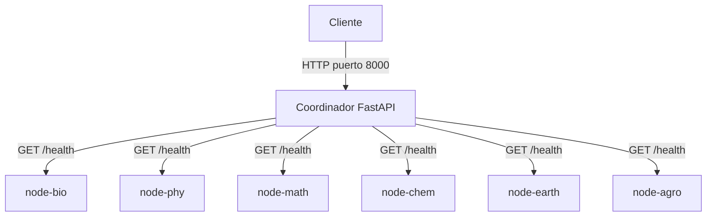

# YachayRepo

YachayRepo es un proyecto académico de Sistemas Distribuidos para construir y
evaluar un repositorio institucional tolerante a fallos. La Etapa 2 incorpora
la comunicación básica entre un coordinador FastAPI y seis nodos lógicos de
almacenamiento, sin implementar todavía gestión de documentos ni replicación.

> No se deben almacenar documentos institucionales reales, confidenciales o
> sensibles en este entorno académico.

## Arquitectura implementada



El **coordinador** es el único punto de acceso publicado al equipo anfitrión.
Su endpoint `GET /health` informa exclusivamente sobre el propio coordinador;
`GET /nodes` consulta los seis nodos concurrentemente mediante HTTPX y valida
la identidad de cada respuesta.

Un **nodo de almacenamiento** es un servicio FastAPI independiente que, en esta
etapa, solo expone su identidad mediante `GET /health`. Los seis contenedores
ejecutan exactamente el mismo código. `NODE_ID` y `SCHOOL_NAME` determinan cuál
escuela representa cada instancia.

| Identificador | Escuela |
|---|---|
| `node-bio` | Escuela de Ciencias Biológicas e Ingeniería |
| `node-phy` | Escuela de Ciencias Físicas y Nanotecnología |
| `node-math` | Escuela de Ciencias Matemáticas y Computacionales |
| `node-chem` | Escuela de Ciencias Químicas e Ingeniería |
| `node-earth` | Escuela de Ciencias de la Tierra, Energía y Ambiente |
| `node-agro` | Escuela de Ciencias Agropecuarias y Agroindustriales |

Las identidades y URLs están centralizadas en `backend/app/config.py`. Cada URL
puede sustituirse mediante las variables `NODE_BIO_URL`, `NODE_PHY_URL`,
`NODE_MATH_URL`, `NODE_CHEM_URL`, `NODE_EARTH_URL` y `NODE_AGRO_URL`. El timeout
se configura con `NODE_REQUEST_TIMEOUT_SECONDS`.

### Nodos lógicos y físicos

Los seis contenedores son seis **nodos lógicos**, pero al ejecutarse localmente
comparten un solo equipo físico. En el futuro podrán distribuirse entre cuatro
Raspberry Pi cambiando sus URLs, sin modificar la lógica del coordinador. Cuando
se implemente `RF = 3`, la colocación deberá evitar que las tres réplicas de un
documento dependan del mismo dispositivo físico. Esa regla todavía no está
implementada.

## Estructura relevante

```text
Project_Repository/
├── backend/
│   ├── app/
│   │   ├── api/routes.py
│   │   ├── schemas/nodes.py
│   │   ├── services/node_health.py
│   │   ├── config.py
│   │   └── main.py
│   ├── storage/
│   │   ├── application.py
│   │   └── main.py
│   ├── tests/
│   ├── requirements.txt
│   └── requirements-dev.txt
├── infrastructure/
│   ├── docker/
│   │   ├── compose.yaml
│   │   ├── Dockerfile.coordinator
│   │   └── Dockerfile.storage
│   └── raspberry/
├── frontend/
├── prototype/
├── experiments/
└── docs/
```

`prototype/` y `experiments/` conservan intactos los Workshops 6 y 7. La nueva
implementación no importa ni modifica esos servicios.

## Levantar los siete servicios

Requisitos en Ubuntu: Docker Engine con el complemento Docker Compose. Desde la
raíz del repositorio:

```bash
docker compose -f infrastructure/docker/compose.yaml up --build -d
```

El coordinador queda disponible en <http://localhost:8000> y la documentación
interactiva en <http://localhost:8000/docs>. Los puertos de los nodos no se
publican; se comunican mediante la red interna creada por Compose.

Verificar la API:

```bash
curl http://localhost:8000/health
curl http://localhost:8000/nodes
```

Consultar contenedores y logs:

```bash
docker compose -f infrastructure/docker/compose.yaml ps
docker compose -f infrastructure/docker/compose.yaml logs coordinator
docker compose -f infrastructure/docker/compose.yaml logs node-math
```

Detener el sistema sin eliminar sus seis volúmenes:

```bash
docker compose -f infrastructure/docker/compose.yaml down
```

No se debe usar `down -v` durante las pruebas normales porque elimina los
volúmenes preparados para cada nodo.

## Prueba manual de fallo

1. Levanta el sistema y confirma inicialmente los seis estados:

   ```bash
   curl http://localhost:8000/nodes
   ```

2. Detén el nodo matemático y vuelve a consultar:

   ```bash
   docker compose -f infrastructure/docker/compose.yaml stop node-math
   curl http://localhost:8000/nodes
   ```

   `node-math` debe aparecer como `unavailable`; los otros cinco deben continuar
   como `healthy`.

3. Inicia el nodo y verifica su recuperación:

   ```bash
   docker compose -f infrastructure/docker/compose.yaml start node-math
   curl http://localhost:8000/nodes
   ```

## Pruebas automatizadas

Usando el entorno virtual creado en la raíz:

```bash
source .venv/bin/activate
python -m pip install -r backend/requirements-dev.txt
python -m pytest backend/tests
```

Las pruebas no requieren Docker ni Raspberry Pi. Utilizan el transporte de
prueba de HTTPX para simular respuestas correctas, conexiones fallidas,
timeouts, HTTP 500, JSON inválido e identidades incorrectas. También verifican
que las seis consultas se inicien concurrentemente.

## Comportamiento actual

- `GET /health` del coordinador responde aunque todos los nodos estén caídos.
- `GET /nodes` siempre conserva los seis nodos y el orden configurado.
- Un nodo solo se clasifica como `healthy` si devuelve HTTP satisfactorio, JSON
  válido, `status=ok`, `service=storage` y el identificador esperado.
- Cada nodo posee un volumen Docker independiente montado en `/data`.
- Las imágenes se basan en Python `slim`, sin dependencias específicas de x86 ni
  una plataforma `linux/amd64` forzada, para permitir builds ARM64 posteriores.

## Funcionalidades todavía no implementadas

Esta etapa no incluye frontend, PostgreSQL, metadatos persistentes, subida o
descarga de documentos, versionamiento, replicación, RabbitMQ, monitoreo
periódico, recuperación automática, autenticación, autorización, cifrado,
balanceo de carga ni despliegue físico sobre Raspberry Pi.

La siguiente etapa deberá definir primero el modelo de documentos y metadatos,
incorporar PostgreSQL al coordinador y diseñar el contrato para guardar archivos
en los nodos. La replicación debe añadirse después de que ese flujo básico sea
verificable.
