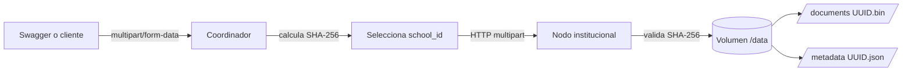

# Almacenamiento documental — Etapa 3

La Etapa 3 añade documentos reales a la arquitectura distribuida existente.
El coordinador continúa en Host A y selecciona uno de los seis nodos de Host B
según `school_id`. El factor de replicación temporal es **RF = 1**: cada
documento tiene una sola copia y no existe recuperación automática.



## Responsabilidades

El coordinador:

- valida la escuela, el nombre, el tamaño y que el archivo no esté vacío;
- calcula SHA-256 por bloques;
- genera un UUID y una fecha UTC;
- selecciona el nodo usando la configuración institucional;
- transmite el archivo sin Base64;
- valida la confirmación del nodo;
- actúa como intermediario para metadatos y descarga;
- vuelve a verificar tamaño y SHA-256 al descargar.

El nodo de almacenamiento:

- acepta documentos únicamente para su propia identidad;
- vuelve a calcular tamaño y SHA-256;
- nunca utiliza el nombre original como ruta;
- publica documentos y metadatos de forma exclusiva;
- rechaza sobrescrituras;
- conserva los datos dentro de su volumen Docker;
- verifica integridad antes de servir una descarga.

## Modelo documental

```json
{
  "document_id": "c48b185d-9bd3-43fc-9e41-3db6faedac80",
  "filename": "informe.pdf",
  "school_id": "node-math",
  "school": "Escuela de Ciencias Matemáticas y Computacionales",
  "size_bytes": 1024,
  "sha256": "64 caracteres hexadecimales",
  "created_at": "2026-11-11T20:00:00Z",
  "node_id": "node-math"
}
```

`document_id` identifica el contenido físico. `filename` se conserva solo como
metadato y para la descarga. `school_id` y `node_id` deben coincidir con la
identidad configurada del nodo.

## Organización del volumen

```text
/data/
├── documents/
│   └── {document_id}.bin
├── metadata/
│   └── {document_id}.json
├── temporary/
└── claims/
```

Una creación exclusiva en `claims/` evita que dos solicitudes concurrentes
publiquen el mismo UUID. El contenido se escribe primero en `temporary/`, se
valida y se publica mediante un enlace exclusivo dentro del mismo sistema de
archivos. Después se publica el JSON de metadatos. Si falla la publicación de
metadatos, se elimina el contenido recién publicado.

No existe una transacción real entre dos archivos. El mecanismo reduce la
ventana de inconsistencia, impide sobrescrituras y limpia resultados parciales,
pero PostgreSQL se incorporará posteriormente para un catálogo transaccional.

## Endpoints

| Método | Ruta | Servicio | Descripción |
|---|---|---|---|
| `GET` | `/health` | Coordinador | Salud del coordinador |
| `GET` | `/nodes` | Coordinador | Salud de los seis nodos |
| `POST` | `/documents` | Coordinador | Carga `file` y `school_id` |
| `GET` | `/documents/{school_id}/{document_id}` | Coordinador | Consulta metadatos |
| `GET` | `/documents/{school_id}/{document_id}/download` | Coordinador | Descarga validada |
| `GET` | `/health` | Nodo | Salud e identidad del nodo |
| `PUT` | `/files/{document_id}` | Nodo | Almacenamiento interno |
| `GET` | `/files/{document_id}/metadata` | Nodo | Metadatos internos |
| `GET` | `/files/{document_id}` | Nodo | Contenido interno validado |

Errores principales:

- `400`: escuela, UUID, archivo o contrato inválido;
- `404`: documento inexistente;
- `409`: identificador existente o corrupción detectada;
- `413`: límite de carga superado;
- `502`: respuesta del nodo mal formada;
- `503`: nodo no disponible o timeout.

## Configuración

```dotenv
MAX_UPLOAD_SIZE_MB=10
DOCUMENT_TRANSFER_TIMEOUT_SECONDS=30.0
```

El límite se comprueba en el coordinador y nuevamente en el nodo. Los archivos
se procesan en bloques de 1 MiB y se usan archivos temporales con tamaño
acotado, por lo que la carga completa no se conserva obligatoriamente en RAM.

## Uso desde Host A

Inicia el coordinador con la configuración remota existente:

```bash
docker compose --env-file infrastructure/docker/.env \
  -f infrastructure/docker/compose.yaml \
  --profile coordinator up --build -d
```

Carga un documento:

```bash
curl -X POST http://localhost:8000/documents \
  -F 'school_id=node-math' \
  -F 'file=@./documento.pdf'
```

Conserva el `document_id` de la respuesta:

```bash
curl http://localhost:8000/documents/node-math/DOCUMENT_ID

curl -OJ \
  http://localhost:8000/documents/node-math/DOCUMENT_ID/download
```

También puede utilizarse <http://localhost:8000/docs>.

## Persistencia y fallos

Reiniciar un contenedor no elimina el volumen:

```bash
docker compose -f infrastructure/docker/compose.yaml restart node-math
```

Si `node-math` está detenido, las operaciones sobre sus documentos devuelven
`503`; el coordinador y los demás nodos continúan disponibles. No se debe usar
`docker compose down -v`, porque eliminaría los volúmenes.

Para verificar integridad manualmente:

```bash
sha256sum documento.pdf
sha256sum archivo_descargado.pdf
```

Los valores deben coincidir con el campo `sha256` de los metadatos.

## Pruebas automatizadas

```bash
source .venv/bin/activate
python -m pip install -r backend/requirements-dev.txt
python -m pytest backend/tests
```

Las pruebas usan directorios temporales y transportes HTTP simulados. No
modifican los volúmenes Docker reales ni requieren dos computadoras.

## Limitaciones

- RF = 1: la caída o pérdida del volumen hace inaccesible la única copia.
- No hay PostgreSQL ni catálogo central para localizar un documento sin conocer
  `school_id`.
- No hay replicación, reparación, versiones, autenticación ni autorización.
- HTTP no tiene TLS y solo debe utilizarse en la red académica local confiable.
