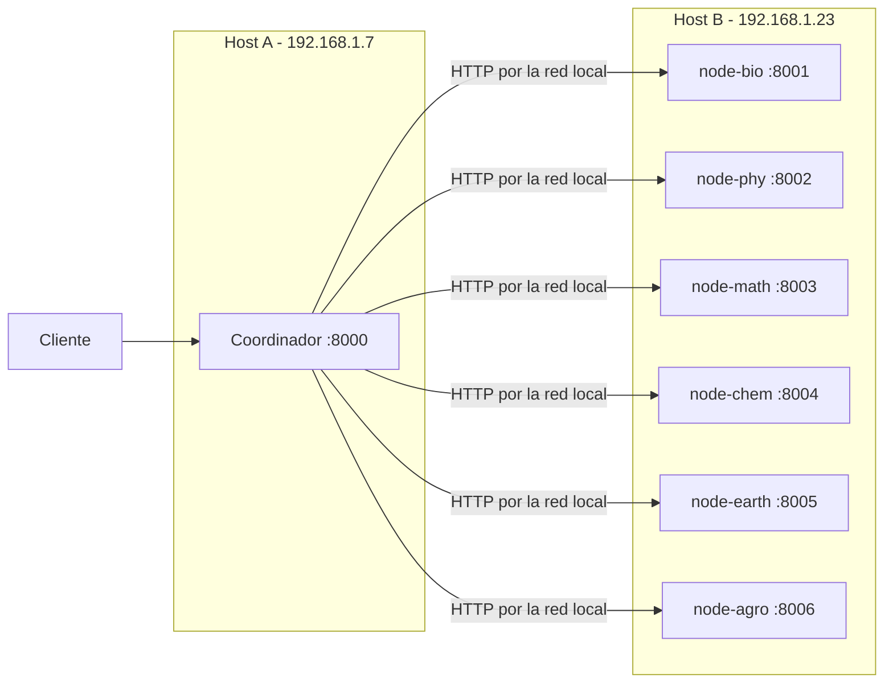

# Despliegue de YachayRepo entre dos hosts Ubuntu

Esta guía distribuye la Etapa 2 entre dos computadoras de una misma red local.
Ambos desarrolladores utilizan el mismo repositorio y la misma revisión del
código, pero activan perfiles de Docker Compose diferentes.



Las direcciones mostradas corresponden al laboratorio actual. Si la red asigna
otras IP, se cambia el archivo local de entorno; no se modifica código Python.

## Requisitos comunes

- Ubuntu con Docker Engine y Docker Compose.
- Ambos equipos conectados a la misma red local confiable.
- La misma versión del repositorio en ambos equipos.
- Los puertos `8000` a `8006` libres según el rol de cada host.

Los nodos se exponen mediante HTTP sin autenticación ni TLS exclusivamente para
pruebas académicas en la red local. No deben publicarse directamente en
Internet.

## Host B: seis nodos de almacenamiento

En el equipo `192.168.1.23`, desde la raíz del repositorio:

```bash
docker compose -f infrastructure/docker/compose.yaml --profile storage up --build -d
```

Este perfil inicia únicamente los seis nodos. Cada contenedor escucha en el
puerto interno `8000`, publica un puerto diferente del host y conserva su propio
volumen:

| Servicio | Puerto del Host B | Volumen |
|---|---:|---|
| `node-bio` | 8001 | `storage_bio` |
| `node-phy` | 8002 | `storage_phy` |
| `node-math` | 8003 | `storage_math` |
| `node-chem` | 8004 | `storage_chem` |
| `node-earth` | 8005 | `storage_earth` |
| `node-agro` | 8006 | `storage_agro` |

Comprobar los contenedores:

```bash
docker compose -f infrastructure/docker/compose.yaml ps
```

Comprobar cada nodo desde el propio Host B:

```bash
curl http://192.168.1.23:8001/health
curl http://192.168.1.23:8002/health
curl http://192.168.1.23:8003/health
curl http://192.168.1.23:8004/health
curl http://192.168.1.23:8005/health
curl http://192.168.1.23:8006/health
```

## Host A: coordinador

En el Dell G15 `192.168.1.7`, copia el ejemplo a un archivo local ignorado por
Git:

```bash
cp infrastructure/docker/.env.example infrastructure/docker/.env
```

Revisa `infrastructure/docker/.env`. Su configuración inicial es:

```dotenv
NODE_BIO_URL=http://192.168.1.23:8001
NODE_PHY_URL=http://192.168.1.23:8002
NODE_MATH_URL=http://192.168.1.23:8003
NODE_CHEM_URL=http://192.168.1.23:8004
NODE_EARTH_URL=http://192.168.1.23:8005
NODE_AGRO_URL=http://192.168.1.23:8006
NODE_REQUEST_TIMEOUT_SECONDS=2.0
```

Inicia únicamente el coordinador y transmite explícitamente ese archivo a
Compose:

```bash
docker compose --env-file infrastructure/docker/.env \
  -f infrastructure/docker/compose.yaml \
  --profile coordinator up --build -d
```

Verifica el servicio:

```bash
curl http://localhost:8000/health
curl http://localhost:8000/nodes
```

Swagger UI está disponible en <http://localhost:8000/docs>.

## Prueba de fallos entre los dos hosts

Con ambos perfiles activos, comprueba primero que los seis nodos sean
`healthy` desde Host A:

```bash
curl http://localhost:8000/nodes
```

En Host B, detén `node-math`:

```bash
docker compose -f infrastructure/docker/compose.yaml stop node-math
```

La siguiente consulta en Host A debe mostrar `node-math` como `unavailable` y
los otros cinco como `healthy`:

```bash
curl http://localhost:8000/nodes
```

Restaura el nodo desde Host B:

```bash
docker compose -f infrastructure/docker/compose.yaml start node-math
```

Para probar múltiples fallos:

```bash
docker compose -f infrastructure/docker/compose.yaml stop node-phy node-earth
docker compose -f infrastructure/docker/compose.yaml start node-phy node-earth
```

## Prueba local en una sola computadora

Sin archivo remoto, los valores predeterminados usan los nombres DNS internos
de Compose. Activa ambos perfiles:

```bash
docker compose -f infrastructure/docker/compose.yaml \
  --profile coordinator --profile storage up --build -d
```

Así se conserva el modo de desarrollo local de la Etapa 2.

## Logs y apagado

En Host A:

```bash
docker compose -f infrastructure/docker/compose.yaml logs coordinator
docker compose -f infrastructure/docker/compose.yaml --profile coordinator down
```

En Host B:

```bash
docker compose -f infrastructure/docker/compose.yaml logs node-math
docker compose -f infrastructure/docker/compose.yaml --profile storage down
```

`down` no elimina los volúmenes. No utilices `down -v` durante las pruebas
normales.

## Diagnóstico

- **IP incorrecta:** confirma la IP actual del Host B y actualiza el `.env` de
  Host A.
- **Puerto cerrado:** prueba cada URL con `curl` desde Host A.
- **Firewall:** verifica manualmente las reglas de Ubuntu. Esta guía no cambia
  el firewall automáticamente.
- **Contenedor detenido:** ejecuta `docker compose ... ps` en Host B.
- **Servicio solo en localhost:** Uvicorn debe continuar escuchando en
  `0.0.0.0` dentro del contenedor.
- **IP del host frente a IP Docker:** Host A debe usar la IP Wi-Fi del Host B,
  no la IP interna de un contenedor.
- **Timeout:** ajusta `NODE_REQUEST_TIMEOUT_SECONDS` de forma moderada si la
  latencia medida de la red lo requiere; no desactives el timeout.

Esta configuración no modifica Wi-Fi, firewall ni equipos remotos. Cualquier
cambio de red debe realizarse y validarse manualmente por los responsables del
laboratorio.

## Operaciones documentales de la Etapa 3

Con el perfil `storage` activo en Host B y el perfil `coordinator` activo en
Host A, Swagger UI permite cargar, consultar y descargar documentos mediante el
coordinador:

```text
http://localhost:8000/docs
```

Prueba desde Host A:

```bash
curl -X POST http://localhost:8000/documents \
  -F 'school_id=node-math' \
  -F 'file=@./documento.pdf'
```

El archivo queda en el volumen de `node-math`. Reiniciar ese contenedor conserva
el contenido; detenerlo hace que el coordinador devuelva `503` para sus
documentos sin afectar los otros nodos. La arquitectura, endpoints, integridad
y limitaciones de RF = 1 se explican en
[`document-storage.md`](document-storage.md).
